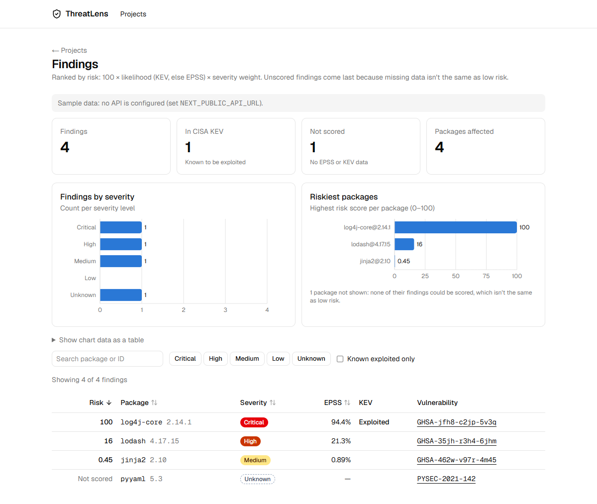

# web

Next.js frontend, built as a static export (`out/`) for S3 + CloudFront. It calls the API from the browser.

```bash
corepack enable          # once, gives you the pinned pnpm
pnpm install             # from the repo root
cd apps/web
pnpm dev                 # http://localhost:3000
pnpm test                # vitest
pnpm lint && pnpm typecheck
pnpm build               # writes out/
```

Needs Node 22.12 or newer (Vite 8 / Vitest 5).

Without `NEXT_PUBLIC_API_URL` the project list runs on labelled sample data. The projects API arrives on Day 13.

Security headers (CSP, HSTS, frame options) are not set here: a static export has no server, so CloudFront adds them (Day 15/16).

## Pages

- `/`: project list.
- `/findings?project=<id>`: summary and findings for one project.
  - Four headline numbers: findings, in CISA KEV, not scored, packages affected.
  - Two charts: findings per severity, and the riskiest packages by their highest risk score.
  - Below that, a sortable, filterable table with a detail drawer.



The charts never draw a missing score as zero. A package whose findings all lack EPSS and KEV data is left out of the risk chart and counted in a note underneath. Each chart has a one-sentence text alternative for screen readers, and the same numbers are in a "Show chart data as a table" section. Bars use one blue (`--chart-1`), checked for contrast against the light and dark backgrounds.
