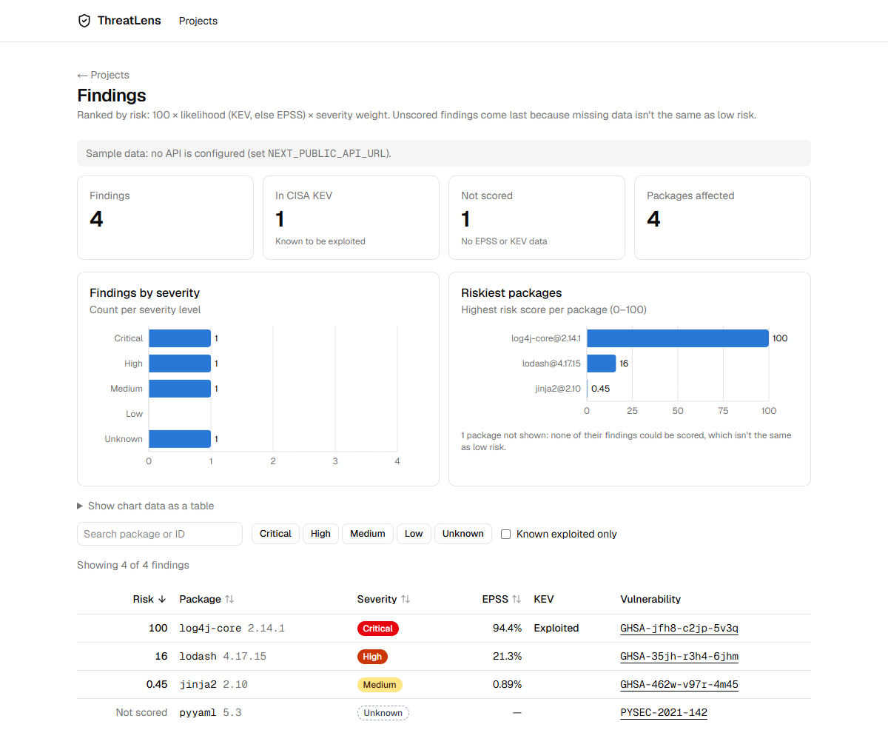
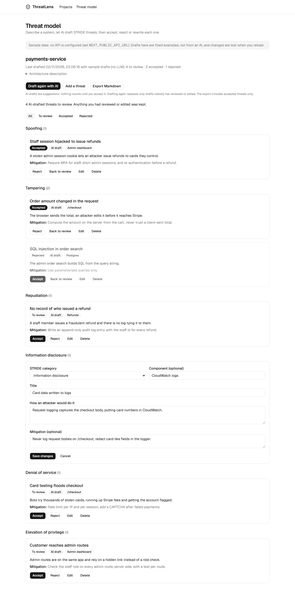

# web

Next.js frontend, built as a static export (`out/`) for S3 + CloudFront. It calls the API from the browser.

```bash
corepack enable          # once, gives you the pinned pnpm
pnpm install             # from the repo root
cd apps/web
pnpm dev                 # http://localhost:3000
pnpm test                # vitest
pnpm lint && pnpm typecheck
pnpm build               # writes out/
```

Needs Node 22.12 or newer (Vite 8 / Vitest 5).

End-to-end test (Playwright, Chromium): build against `/api` first, then run it. It starts the API in local mode and serves `out/` the way CloudFront does, using the real CloudFront function files, with `/api` passed to the API.

```bash
NEXT_PUBLIC_API_URL=/api NEXT_PUBLIC_AUTH_MODE=local pnpm build   # in PowerShell on Windows: Git Bash rewrites /api
pnpm exec playwright install chromium                            # once
pnpm test:e2e
```

One journey, in about 6 seconds:
- sign in;
- create a threat model, and see drafting refused because the server has no AI key;
- add a threat, send it back to review, accept it again, and export the Markdown;
- reload, to check the API saved it;
- open a project's findings page from the list;
- sign out;
- a second user gets "doesn't exist, or you don't have access" for the first user's model.

Any browser error or failed API call that isn't one of those two expected answers fails the test.

Without `NEXT_PUBLIC_API_URL` the project list runs on labelled sample data. The projects API arrives on Day 13.

Security headers (CSP, HSTS, frame options) are not set here: a static export has no server, so CloudFront adds them (Day 15/16).

## Pages

- `/sign-in`, `/auth/callback`: sign-in (a username form against the API's local issuer in dev, Cognito's hosted page in prod). Every other page sends a signed-out visitor here and back. With no API configured there's nothing to sign in to, and the pages show labelled sample data. In dev, restarting the API signs everyone out: its stand-in issuer makes a new key at each start, so old tokens get a 401. That's on purpose.
- `/`: project list.
- `/findings?project=<id>`: summary and findings for one project.
  - Four headline numbers: findings, in CISA KEV, not scored, packages affected.
  - Two charts: findings per severity, and the riskiest packages by their highest risk score.
  - Below that, a sortable, filterable table with a detail drawer.



The charts never draw a missing score as zero. A package whose findings all lack EPSS and KEV data is left out of the risk chart and counted in a note underneath. Each chart has a one-sentence text alternative for screen readers, and the same numbers are in a "Show chart data as a table" section. Bars use one blue (`--chart-1`), checked for contrast against the light and dark backgrounds.

- `/threat-model`: describe a system (name + architecture text) to start a threat model.
- `/threat-model?id=<id>`: the threat model.
  - Draft STRIDE threats with AI, grouped by category and filterable by status.
  - Accept, reject, send back to review, edit inline, delete (with a confirm step), or add your own.
  - Export the accepted threats as Markdown.



The page only shows what the API confirmed: each change waits for the server's answer, and a failed one shows its error on that card and leaves it as it was. Drafting errors (drafting turned off, hourly limit, the AI declining, a bad answer, the provider down) each get their own plain message, and the server's own error text is never shown. Saving an unchanged edit sends nothing, so the threat isn't marked "edited". In the export, every piece of threat text is escaped, so it can't add links, images or HTML when the file is rendered. With no API configured, the page runs on an in-memory sample with fixed example drafts, labelled as such.
