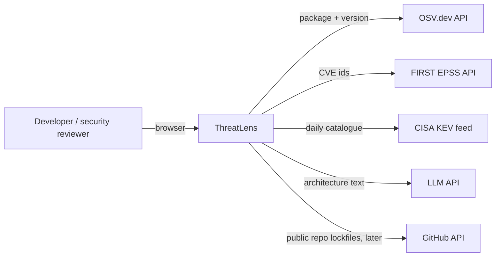
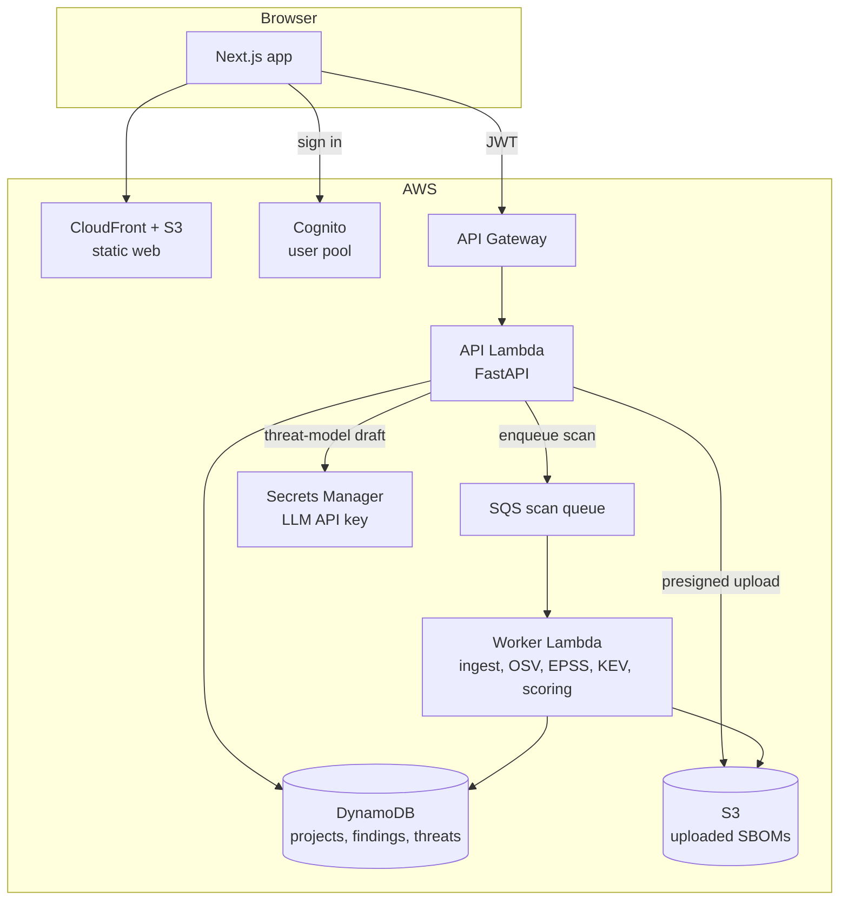
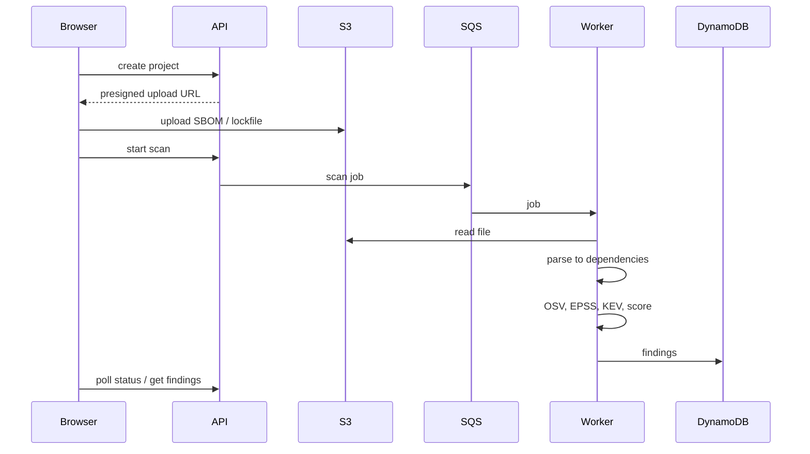

# Architecture (v1)

First version, written before any code. It will change as the build teaches me things, and each change gets a line under "Decisions".

## Context

ThreatLens only reads from outside services. It never sends a user's code anywhere: only package names and versions go to OSV, CVE ids to EPSS, and the architecture description the user wrote to the LLM.

## Containers

| Container | Responsibility |
|-----------|----------------|
| Web (Next.js) | Project list, findings table, dashboard, threat-model editor |
| API (FastAPI on Lambda) | Auth check, CRUD for projects/findings/threats, starts scans, calls the LLM for drafts |
| Worker (Lambda, SQS-triggered) | Parses the SBOM, queries OSV, enriches with EPSS + KEV, computes the risk score, writes findings |
| DynamoDB | One table, partitioned by user, so a user can only ever query their own items |
| S3 (uploads) | Raw SBOM files, private bucket, short-lived presigned URLs |
| Cognito | Sign-up/sign-in, issues JWTs that API Gateway checks |

Local development runs the API and worker as plain processes, with an in-memory queue and a local DynamoDB, so no AWS account is needed to work on it.

## Data flow: a scan

## Risk score (first idea)

`risk = EPSS probability × severity weight × (2 if in KEV else 1)`, capped to 0–100. Simple on purpose, so every number on screen can be explained. The unit tests on Day 6 will pin it down.

## Decisions

| # | Decision | Why |
|---|----------|-----|
| 1 | Serverless (Lambda + API Gateway + DynamoDB), not ECS + RDS | Almost free when idle, which matters for a portfolio project that's mostly not in use. The trade-off is cold starts |
| 2 | Scans run async through SQS | Big SBOMs need hundreds of OSV/EPSS calls. That shouldn't hold an HTTP request open, and SQS retries failed jobs |
| 3 | LLM output is a *draft* that a person must accept | The model can invent threats or miss real ones. Nothing it says counts until a human accepts it |
| 4 | Single-table DynamoDB with the user id in the partition key | Per-user isolation comes from the key design, not only from app code |
| 5 | GitHub Actions to AWS with OIDC | No long-lived AWS keys stored anywhere |

## Threat model of ThreatLens (STRIDE)

Trust boundaries: browser ↔ API Gateway, API ↔ outside APIs (OSV, EPSS, KEV, LLM), worker ↔ uploaded files.

| STRIDE | Threat | Mitigation |
|--------|--------|------------|
| **Spoofing** | Someone calls the API as another user | Cognito JWTs checked at API Gateway. The user id comes from the token, never from the request body |
| **Tampering** | A crafted SBOM/lockfile exploits the parser (huge file, deep nesting, zip bomb) | Size limit on the presigned upload, strict parsers with depth limits, the worker has no network access except the allow-listed APIs |
| **Tampering** | Prompt injection in the architecture text changes the LLM's output | The output must match a fixed schema (STRIDE category, threat, mitigation). It's shown as a draft only and never executed or used to call tools |
| **Repudiation** | A user denies accepting or rejecting a threat | Every accept/reject is stored with the user id and a timestamp. API calls are logged to CloudWatch |
| **Information disclosure** | One user reads another's projects (IDOR) | Partition key includes the user id, and tests check that cross-user reads return 404 |
| **Information disclosure** | The LLM API key leaks | Kept in Secrets Manager, read at runtime by the API role only. Gitleaks in CI and push protection on the repo |
| **Information disclosure** | Uploaded SBOMs are publicly readable | Private bucket, block public access, KMS encryption, presigned URLs that expire in minutes |
| **Denial of service** | Huge scans or many scans run up the AWS bill | API Gateway throttling, per-user scan limit, SQS batch size limit, AWS budget alarm |
| **Denial of service** | OSV/EPSS rate-limit or go down | Cache responses in DynamoDB with a TTL, back off and retry, and mark the scan "partial" instead of failing |
| **Elevation of privilege** | A compromised Lambda reaches other AWS resources | One IAM role per function, least privilege (the worker can't read secrets, the API can't read the queue) |
