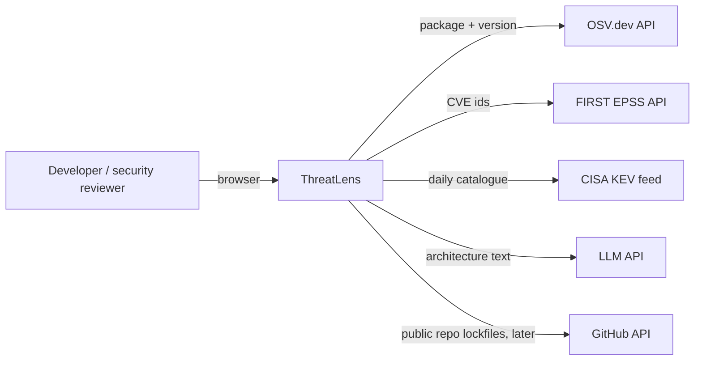
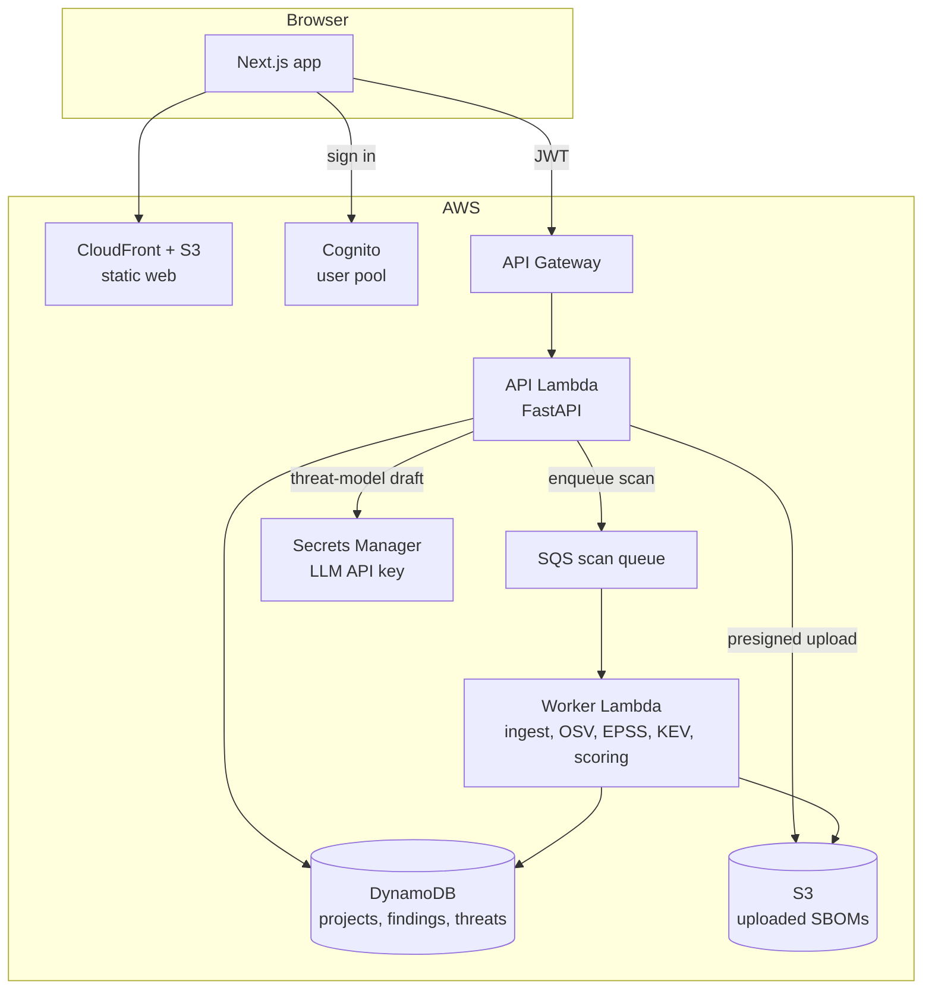
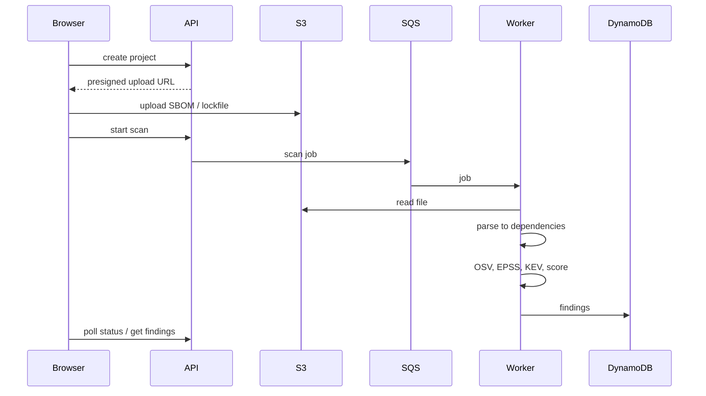

# Architecture (v1)

First version, written before any code. It will change as the build teaches me things, and each change gets a line under "Decisions".

## Context



ThreatLens only reads from outside services. It never sends a user's code anywhere: only package names and versions go to OSV, CVE ids to EPSS, and the architecture description the user wrote to the LLM.

## Containers



| Container | Responsibility |
|-----------|----------------|
| Web (Next.js) | Project list, findings table, dashboard, threat-model editor |
| API (FastAPI on Lambda) | Auth check, CRUD for projects/findings/threats, starts scans, calls the LLM for drafts |
| Worker (Lambda, SQS-triggered) | Parses the SBOM, queries OSV, enriches with EPSS + KEV, computes the risk score, writes findings |
| DynamoDB | One table, partitioned by user, so a user can only ever query their own items |
| S3 (uploads) | Raw SBOM files, private bucket, short-lived presigned URLs |
| Cognito | Sign-up/sign-in, issues JWTs that API Gateway checks |

Local development runs the API and worker as plain processes, with an in-memory queue and a local DynamoDB, so no AWS account is needed to work on it.

## Data flow: a scan



## Risk score

```
risk       = 100 × likelihood × severity weight
likelihood = 1.0 if the CVE is in CISA KEV, else its EPSS probability
weights    = critical 1.0, high 0.75, medium 0.5, low 0.25, unknown 0.5
```

A bug with several CVE aliases takes the highest EPSS of them, and counts as in KEV if any of them is. Findings are sorted by risk, then severity. A finding with no EPSS score that is not in KEV is left **unscored** (shown after the scored ones), because "no data" is not "no risk".

Example from a live scan on 28 Oct 2026: log4j-core 2.14.1's Log4Shell CVEs are in KEV and score 100; lodash 4.17.15's CVE-2021-23337 (HIGH, EPSS 0.213) scores 16.0; jinja2 2.10's sandbox escape (MEDIUM, EPSS 0.00892) scores 0.446.

The first idea was `EPSS × weight × (2 if in KEV)`. On real numbers that left a KEV entry with EPSS 0.01 below an unexploited bug with EPSS 0.2, which is backwards: KEV is evidence of exploitation, EPSS is only a forecast.

## Decisions

| # | Decision | Why |
|---|----------|-----|
| 1 | Serverless (Lambda + API Gateway + DynamoDB), not ECS + RDS | Almost free when idle, which matters for a portfolio project that's mostly not in use. The trade-off is cold starts |
| 2 | Scans run async through SQS | Big SBOMs need hundreds of OSV/EPSS calls. That shouldn't hold an HTTP request open, and SQS retries failed jobs |
| 3 | LLM output is a *draft* that a person must accept | The model can invent threats or miss real ones. Nothing it says counts until a human accepts it |
| 4 | Single-table DynamoDB with the user id in the partition key | Per-user isolation comes from the key design, not only from app code |
| 5 | GitHub Actions to AWS with OIDC | No long-lived AWS keys stored anywhere |
| 6 | Ingest keeps only exact versions; everything else goes in a `skipped` list with a reason (Day 4) | OSV answers "is version X affected", so `numpy>=1.24` can't be checked. Showing what wasn't checked is more honest than a clean-looking report that silently missed half the file |
| 7 | Upload limits: 5 MB, 20,000 dependencies, nested CycloneDX walked without recursion | Uploaded files are attacker-controlled input (the Tampering and DoS rows below) |
| 8 | OSV lookups: batch of 1000, cache ids 6 h and details 24 h, retry 429/5xx with capped backoff, no redirects; failures mark a dependency "not checked" (Day 5) | A scan that can't reach OSV must not look clean. Cached answers keep repeat scans fast and polite to a free service |
| 9 | One finding per real bug: records that share an id or alias are merged, keeping the one with a severity | OSV returns jinja2 2.10's 6 bugs as 12 ids (each as GHSA and PYSEC), which would double-count risk |
| 10 | KEV membership sets likelihood to 1.0 instead of doubling EPSS (Day 6) | See "Risk score" above |
| 11 | EPSS: ≤100 CVEs and ≤2000 chars per request, cached 24 h including "EPSS has no score"; values must be finite and in 0–1; a failed chunk leaves its findings unscored and the scan incomplete | The API pages at 100 and documents the 2000-char limit. EPSS publishes once a day |
| 12 | KEV: download the whole feed daily, reject it if `count` doesn't match or it has under 1000 entries, keep using the last good copy for up to 3 days (marked stale) | A truncated feed would make exploited CVEs look unexploited. One 1.8 MB file a day is cheaper than a call per CVE |
| 13 | Web is a Next.js static export (`output: "export"`); the browser calls the API with the user's token (Day 7) | Matches CloudFront + S3 hosting: no server to run or patch. Costs: no `headers()`, `proxy.ts`, redirects or Server Actions, and data loads client-side |
| 14 | CSP comes from a CloudFront response-headers policy, using SHA-256 hashes of the export's inline scripts instead of `'unsafe-inline'` (to build on Day 15/16) | Nonces need a server per request, and Next's docs say nonces don't work with partial prerendering anyway. A static export's 3 inline scripts are fixed at build time, so they can be hashed |
| 15 | No API URL configured → the web app shows labelled sample data; API responses are zod-validated, fetched with no cookies, no redirects, a 10 s timeout and a 2 MB cap | Lets the UI be built before the projects API exists (Day 13) without ever passing sample data off as real |
| 16 | Findings page is `/findings?project=<id>`; the id must be a UUID before it goes into the API path, and a 404 reads "doesn't exist, or you don't have access" (Day 8) | A static export can't pre-render a page per project. One message for missing and forbidden means ids can't be probed |
| 17 | In the findings table, missing risk and EPSS sort last in both directions | Sorting ascending would otherwise put "no data" at the top, where it reads as "safest" |
| 18 | Open: Next 16 prefetches `findings/__next.findings.__PAGE__.txt`, but the export writes `findings/__next.findings/__PAGE__.txt`. Needs a CloudFront rewrite (Day 15/16) | Until then only the prefetch 404s; the link still works as a normal page load |

## Threat model of ThreatLens (STRIDE)

Trust boundaries: browser ↔ API Gateway, API ↔ outside APIs (OSV, EPSS, KEV, LLM), worker ↔ uploaded files.

| STRIDE | Threat | Mitigation |
|--------|--------|------------|
| **Spoofing** | Someone calls the API as another user | Cognito JWTs checked at API Gateway. The user id comes from the token, never from the request body |
| **Tampering** | A crafted SBOM/lockfile exploits the parser (huge file, deep nesting, zip bomb) | Size limit on the presigned upload, strict parsers with depth limits, the worker has no network access except the allow-listed APIs |
| **Tampering** | Prompt injection in the architecture text changes the LLM's output | The output must match a fixed schema (STRIDE category, threat, mitigation). It's shown as a draft only and never executed or used to call tools |
| **Repudiation** | A user denies accepting or rejecting a threat | Every accept/reject is stored with the user id and a timestamp. API calls are logged to CloudWatch |
| **Information disclosure** | One user reads another's projects (IDOR) | Partition key includes the user id, and tests check that cross-user reads return 404 |
| **Information disclosure** | The LLM API key leaks | Kept in Secrets Manager, read at runtime by the API role only. Gitleaks in CI and push protection on the repo |
| **Information disclosure** | Uploaded SBOMs are publicly readable | Private bucket, block public access, KMS encryption, presigned URLs that expire in minutes |
| **Denial of service** | Huge scans or many scans run up the AWS bill | API Gateway throttling, per-user scan limit, SQS batch size limit, AWS budget alarm |
| **Denial of service** | OSV/EPSS rate-limit or go down | Cache responses in DynamoDB with a TTL, back off and retry, and mark the scan "partial" instead of failing |
| **Elevation of privilege** | A compromised Lambda reaches other AWS resources | One IAM role per function, least privilege (the worker can't read secrets, the API can't read the queue) |
