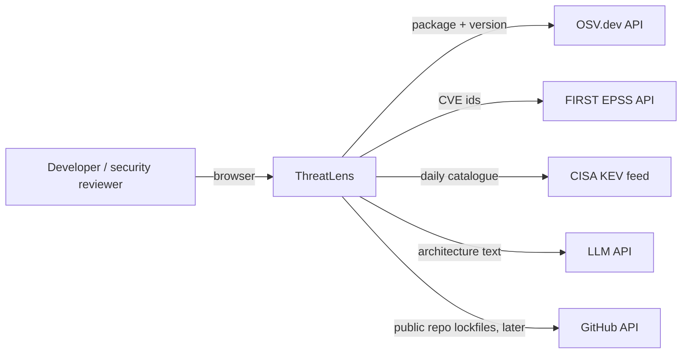
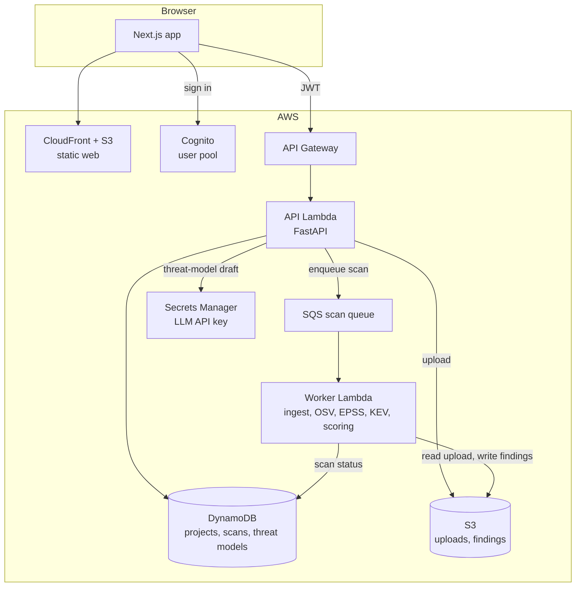
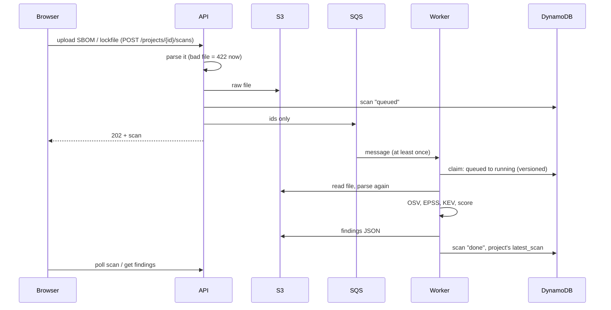

# Architecture (v1)

First version, written before any code. It will change as the build teaches me things, and each change gets a line under "Decisions".

## Context



ThreatLens only reads from outside services. It never sends a user's code anywhere: only package names and versions go to OSV, CVE ids to EPSS, and the architecture description the user wrote to the LLM.

## Containers



| Container | Responsibility |
|-----------|----------------|
| Web (Next.js) | Project list, findings table, dashboard, threat-model editor |
| API (FastAPI on Lambda) | Auth check, CRUD for projects/findings/threats, starts scans, calls the LLM for drafts |
| Worker (Lambda, SQS-triggered) | Parses the SBOM, queries OSV, enriches with EPSS + KEV, computes the risk score, writes findings |
| DynamoDB | One table, partitioned by user, so a user can only ever query their own items. Layout below |
| S3 (uploads) | Raw SBOM files, private bucket, short-lived presigned URLs |
| Cognito | Sign-up/sign-in, issues JWTs that API Gateway checks |

Local development runs the API and worker as plain processes, with an in-memory queue and either the in-memory store or DynamoDB Local, so no AWS account is needed to work on it.

### DynamoDB layout (Day 13)

| pk | sk | Item |
|----|----|------|
| `USER#<sub>` | `TM#<id>` | A threat model with its threats, as one JSON body, plus `ver` (version) and the draft lease (`draft_until`, `draft_lease`) |
| `USER#<sub>` | `PROJECT#<id>` | A project, as JSON |
| `USER#<sub>` | `COUNTS` | `threat_models` and `projects` counts, for the per-user caps |
| `USER#<sub>` | `SCAN#<project>#<id>` | A scan's status and counts, as JSON with `ver`. Its upload and findings are files in S3 |

A project item also carries `latest_scan` and `latest_scan_at` outside its body: the newest finished scan, which only ever moves forward.

Access patterns: get one item by key (strongly consistent read), list a user's projects (Query on `pk` with `begins_with(sk, "PROJECT#")`, every page followed), create (transaction: counter below cap + put if new), change (update if `ver` still matches). Nothing scans the table. The owner's `sub` is never stored in a body; it's the key.

## Data flow: a scan



## Risk score

```
risk       = 100 × likelihood × severity weight
likelihood = 1.0 if the CVE is in CISA KEV, else its EPSS probability
weights    = critical 1.0, high 0.75, medium 0.5, low 0.25, unknown 0.5
```

A bug with several CVE aliases takes the highest EPSS of them, and counts as in KEV if any of them is. Findings are sorted by risk, then severity. A finding with no EPSS score that is not in KEV is left **unscored** (shown after the scored ones), because "no data" is not "no risk".

Example from a live scan on 28 Oct 2026: log4j-core 2.14.1's Log4Shell CVEs are in KEV and score 100; lodash 4.17.15's CVE-2021-23337 (HIGH, EPSS 0.213) scores 16.0; jinja2 2.10's sandbox escape (MEDIUM, EPSS 0.00892) scores 0.446.

The first idea was `EPSS × weight × (2 if in KEV)`. On real numbers that left a KEV entry with EPSS 0.01 below an unexploited bug with EPSS 0.2, which is backwards: KEV is evidence of exploitation, EPSS is only a forecast.

## Decisions

| # | Decision | Why |
|---|----------|-----|
| 1 | Serverless (Lambda + API Gateway + DynamoDB), not ECS + RDS | Almost free when idle, which matters for a portfolio project that's mostly not in use. The trade-off is cold starts |
| 2 | Scans run async through SQS | Big SBOMs need hundreds of OSV/EPSS calls. That shouldn't hold an HTTP request open, and SQS retries failed jobs |
| 3 | LLM output is a *draft* that a person must accept | The model can invent threats or miss real ones. Nothing it says counts until a human accepts it |
| 4 | Single-table DynamoDB with the user id in the partition key | Per-user isolation comes from the key design, not only from app code |
| 5 | GitHub Actions to AWS with OIDC | No long-lived AWS keys stored anywhere |
| 6 | Ingest keeps only exact versions; everything else goes in a `skipped` list with a reason (Day 4) | OSV answers "is version X affected", so `numpy>=1.24` can't be checked. Showing what wasn't checked is more honest than a clean-looking report that silently missed half the file |
| 7 | Upload limits: 5 MB, 20,000 dependencies, nested CycloneDX walked without recursion | Uploaded files are attacker-controlled input (the Tampering and DoS rows below) |
| 8 | OSV lookups: batch of 1000, cache ids 6 h and details 24 h, retry 429/5xx with capped backoff, no redirects; failures mark a dependency "not checked" (Day 5) | A scan that can't reach OSV must not look clean. Cached answers keep repeat scans fast and polite to a free service |
| 9 | One finding per real bug: records that share an id or alias are merged, keeping the one with a severity | OSV returns jinja2 2.10's 6 bugs as 12 ids (each as GHSA and PYSEC), which would double-count risk |
| 10 | KEV membership sets likelihood to 1.0 instead of doubling EPSS (Day 6) | See "Risk score" above |
| 11 | EPSS: ≤100 CVEs and ≤2000 chars per request, cached 24 h including "EPSS has no score"; values must be finite and in 0–1; a failed chunk leaves its findings unscored and the scan incomplete | The API pages at 100 and documents the 2000-char limit. EPSS publishes once a day |
| 12 | KEV: download the whole feed daily, reject it if `count` doesn't match or it has under 1000 entries, keep using the last good copy for up to 3 days (marked stale) | A truncated feed would make exploited CVEs look unexploited. One 1.8 MB file a day is cheaper than a call per CVE |
| 13 | Web is a Next.js static export (`output: "export"`); the browser calls the API with the user's token (Day 7) | Matches CloudFront + S3 hosting: no server to run or patch. Costs: no `headers()`, `proxy.ts`, redirects or Server Actions, and data loads client-side |
| 14 | CSP comes from a CloudFront response-headers policy, using SHA-256 hashes of the export's inline scripts instead of `'unsafe-inline'` (built on Day 15, decision 51) | Nonces need a server per request, and Next's docs say nonces don't work with partial prerendering anyway. A static export's 3 inline scripts are fixed at build time, so they can be hashed |
| 15 | No API URL configured → the web app shows labelled sample data; API responses are zod-validated, fetched with no cookies, no redirects, a 10 s timeout and a 2 MB cap | Lets the UI be built before the projects API exists (Day 13) without ever passing sample data off as real |
| 16 | Findings page is `/findings?project=<id>`; the id must be a UUID before it goes into the API path, and a 404 reads "doesn't exist, or you don't have access" (Day 8) | A static export can't pre-render a page per project. One message for missing and forbidden means ids can't be probed |
| 17 | In the findings table, missing risk and EPSS sort last in both directions | Sorting ascending would otherwise put "no data" at the top, where it reads as "safest" |
| 18 | Resolved on Day 15 (decision 52). Was: Next 16 prefetches `findings/__next.findings.__PAGE__.txt` (and the same for `threat-model/`), but the export writes `findings/__next.findings/__PAGE__.txt`. Needs a CloudFront rewrite (Day 15/16) | Until then only the prefetch 404s; the link still works as a normal page load |
| 19 | LLM drafting goes through a small `Drafter` interface; the one adapter is Claude (`claude-opus-5-5`), and it's **off unless `THREATLENS_LLM_PROVIDER=anthropic`** and a key is set (Day 10) | No key, no outbound call, no cost until it's switched on on purpose. Tests use a fake drafter and the real SDK against a mocked HTTP layer, so the suite never needs a key |
| 20 | Structured JSON output from the API, then validated again with our own Pydantic models: bad items dropped, duplicates dropped, at most 25 threats, and zero usable threats is an error | The API schema can't express our length limits. Failing closed means a broken answer never shows up as an empty "no threats" model |
| 21 | Re-drafting replaces only untouched LLM drafts. Anything accepted, rejected, edited or written by hand stays | A second draft must never throw away a person's review work |
| 22 | At most 20 drafts per rolling hour across the API (`THREATLENS_LLM_DRAFTS_PER_HOUR`), counted before the call | Each draft is a paid call. A failed call can still be billed, so it still counts |
| 23 | Server-side refusal fallback (`fallbacks: "default"`) is on | Threat modelling describes attacks, so a safety classifier can decline. The API then retries on its fallback model; if that also declines, the user gets "write the threats by hand" |
| 24 | Threat-model page applies a change only after the API confirms it; ids go into a path only after a UUID check; error codes are read from an allow-list and the server's message is dropped (Day 11) | A reviewed threat model is a record. The screen must never show an accept the server didn't save |
| 25 | Markdown export holds accepted threats only and escapes all threat text | The text came from a user or an LLM that read user input. Unescaped, it could add links or images (tracking pixels) when the file is rendered on GitHub |
| 26 | The API checks every access token itself: RS256 only (checked before any key lookup), issuer, expiry with 30 s leeway, `token_use=access` and our `client_id`; the user id is the token's `sub` (Day 12) | API Gateway's JWT authorizer will check too, but the API must not depend on it: the local dev path has no gateway. Pinning RS256 stops `alg: none` and HS256-with-the-public-key forgeries. ID tokens and tokens for another app client of the same pool are refused |
| 27 | Local dev uses a stand-in issuer inside the API (`POST /dev/token`, key made at startup and never stored). The settings refuse it in prod | Dev and prod run the same token checks, with no Cognito pool needed until Day 16 and no shared dev key to leak |
| 28 | A threat model belongs to one user. Someone else's model gets the same 404 as a missing one. Caps per user (50 models, 5 drafts an hour) as well as overall | No id probing. One account can't fill the store or spend everyone's drafts |
| 29 | Web sign-in: Cognito hosted UI with authorization code + PKCE (no client secret), one-time `state` checked and deleted on return, code removed from the address bar. Only the access token is kept, in `sessionStorage`; ID and refresh tokens are dropped. `?next=` must be a same-site path | A static site can't keep an httpOnly cookie, so the token is readable by script and the strict CSP (decision 14) is the XSS defence. Tab-only storage and no refresh token cap a stolen token at its one-hour life. A checked `next` stops open redirects |
| 30 | Sign-in is skipped when no API is configured | The app then shows only labelled sample data, and there's nothing to protect |
| 31 | Tokens are checked in the threadpool, Cognito's keys are fetched at startup, and after a failed key fetch the API answers 503 (with `Retry-After`) for 30 s without trying again. Keys already cached keep working | The key fetch is a blocking call with a 5 s timeout. On the event loop it would stall every request, `/health` included, and during an outage each sign-in check would hold a worker for the full timeout |
| 32 | Threats live inside their threat model's item, not as items of their own | Every change touches the whole model anyway (re-drafting swaps a set of threats at once), and one item makes every change atomic. 100 threats of maximum length in 4-byte characters would pass DynamoDB's 400 KB limit, so a save over 350 KB is refused with `409 too_large`, never truncated |
| 33 | Optimistic locking: every save says which version it read, and fails if another save came first. The store then re-reads, applies the change again (re-checking duplicates and caps) and tries up to 3 times, then answers `409 edit_conflict` | Lambda runs many copies of the API at once. Without a version check, two edits at the same moment would silently drop one |
| 34 | Per-user caps are enforced in a transaction with the write (a counter item with a condition), not by counting first | Count-then-write lets two creates at the same moment both pass the check |
| 35 | The draft guard is a lease on the model item (conditional update, 6 minutes, released only by its own holder), replacing the per-process set from Day 10 | It holds across API instances, and if a process dies mid-draft the lease runs out instead of locking the model forever |
| 36 | The in-memory store keeps a global cap (500 items) and is refused in prod. DynamoDB has no global cap; per-user caps plus admin-created accounts (Day 16) bound the total | Answers the #18 review: with a global cap of 500 and 50 per user, ten throwaway accounts would block everyone else. A global counter item would also be a single hot key |
| 37 | Store calls are blocking (boto3), so routes that touch the store are plain `def` (threadpool) and the async draft route sends its store calls to the threadpool | Same reason as decision 31: a blocking call on the event loop stalls every request |
| 38 | DynamoDB throttling and outages are `503 storage_busy` / `storage_unavailable` with `Retry-After`. A stored item that fails validation is a 500 and is logged by key only, never served half-read. Other DynamoDB errors (missing table, no permission) are not dressed up as a 503 | Busy is the client's to retry. A broken item or wrong IAM policy is ours to fix, and should be loud |
| 39 | A per-user budget of 20,000 DynamoDB write units an hour (1 per KB of item written, failed conditional writes included) across threat models and projects. Over it: `429 write_limit` with `Retry-After` | Every threat edit rewrites the whole model, up to ~340 units. A script editing a big model in a loop would cost a few hundred dollars a day with no LLM call involved; a request count alone wouldn't bound that. The budget caps one account at about $0.60 a day per API copy. It's per process, so API Gateway throttling (Day 16) is the shared limit |
| 40 | Findings are one JSON file per scan in S3, not DynamoDB items (changes the Day 1 plan) | Written once and read whole, and up to 20,000 per scan. As items, a big scan would cost thousands of write units; as one S3 object it's one PUT. Scan status stays in DynamoDB, where the versioned saves are |
| 41 | The API parses the upload before queueing; the worker does the network part (OSV, EPSS, KEV) | A bad file is refused at once with `422 bad_file`, not minutes later. On a real 4-line file the upload answered in 0.22 s and the scan took 22 s |
| 42 | Queue messages carry ids only (`owner`, `project_id`, `scan_id`); the worker reads everything else back by key | A message can't carry data of its own, and one naming another user's scan finds nothing, because the owner is the key |
| 43 | The worker assumes at-least-once delivery: done/failed scans are skipped, the queued-to-running claim is a versioned save only one worker wins, a scan "running" for over 15 minutes is taken over, and 3 attempts then `failed` with a fixed message | SQS can deliver twice, and a Lambda can die mid-scan. The visibility timeout (Day 16) must be at least 15 minutes, or a live scan gets a twin. Crash details stay in the logs |
| 44 | The worker Lambda reports failures per message (`batchItemFailures`) | One bad scan doesn't make the whole batch run again |
| 45 | Without an SQS queue (local work) scans run in a thread inside the API; prod requires a queue URL and a bucket | No AWS needed to work on it, and prod can't fall back to the thread by accident |
| 46 | 10 scans per user per hour, 200 for the whole API | OSV, EPSS and KEV are free public services; one account mustn't hammer them through us |
| 47 | Uploads go through the API for now, capped at 1 MB and counted while reading (a chunked body has no Content-Length) | Simple until Terraform (Day 15–16). Then presigned S3 uploads, which also lift the size limit |
| 48 | CloudFront serves the site and `/api/*` (to API Gateway, prefix stripped by a function) on one origin (Day 15) | No CORS anywhere, `connect-src 'self'`, and the web build doesn't depend on any AWS address, which also breaks the loop of build → CSP hashes → apply → API URL → build |
| 49 | The API's CloudFront behaviour uses a cache policy with `Authorization` in the key and `max_ttl` 1 | CloudFront only forwards `Authorization` if it's part of the cache key; the API sends `Cache-Control: no-store`, so nothing is cached in practice |
| 50 | No CloudFront custom error page; CloudFront may list the bucket | Error pages apply to every behaviour and would replace the API's JSON 404/403 with HTML. With list access a missing file is a plain 404, not S3's 403 |
| 51 | CSP hashes are computed from the actual export (`infra/scripts/csp-hashes.mjs`) and passed to Terraform as a variable | Resolves decision 14. The export has 8 distinct inline scripts, a 647-character policy, under CloudFront's 1,783 limit. Checked in Chromium under the real policy with 0 violations |
| 52 | Decision 18 resolved by the pages function: `/a/b/__next.a.b.__PAGE__.txt` → `/a/b/__next.a/b/__PAGE__.txt`, plus clean URLs → `.html` | Tested against every file of a real export, and seen working for 3 real prefetches in the browser run |
| 53 | API Lambda: Mangum on Python 3.12 x86_64, zip built from the lockfile with Linux wheels (60 MB unzipped, budget 150), smoke-tested in AWS's Lambda image in CI; 29 s timeout, X-Ray on, IAM limited to its own log group | x86_64 so CI can run the real runtime image without emulation. A wrong-platform wheel fails in CI, not after a deploy |
| 54 | API Gateway checks the Cognito JWT first (except `GET /health`), stage throttling 20 rps / burst 40, access logs without headers, query strings or bodies | Bad tokens never cost a Lambda call, and the throttle is the one limit shared across every Lambda copy (decision 39). The app still checks tokens itself |
| 55 | Budget alarm (50% and 100% actual, 100% forecast) is in the first Terraform, ahead of the plan's Day 17 | It must exist before anything is ever applied |

## Threat model of ThreatLens (STRIDE)

Trust boundaries: browser ↔ API Gateway, API ↔ outside APIs (OSV, EPSS, KEV, LLM), worker ↔ uploaded files.

| STRIDE | Threat | Mitigation |
|--------|--------|------------|
| **Spoofing** | Someone calls the API as another user | Cognito access tokens checked at API Gateway and again in the API (decision 26), with tests for expired, wrong-issuer, wrong-client, ID-token, `alg: none`, HS256 and tampered tokens. The user id comes from the token, never from the request body |
| **Spoofing** | The sign-in callback is used to log a victim into the attacker's account (login CSRF), or `?next=` sends them to a look-alike site | One-time `state` per tab, checked before the code is exchanged, and PKCE. `next` accepts same-site paths only (decision 29) |
| **Tampering** | A crafted SBOM/lockfile exploits the parser (huge file, deep nesting, zip bomb) | Size limit on the presigned upload, strict parsers with depth limits, the worker has no network access except the allow-listed APIs |
| **Tampering** | Prompt injection in the architecture text changes the LLM's output | The text is wrapped in `<architecture>` tags (a closing tag inside it is defanged) and the system prompt says it's data, not instructions. The output must match a fixed schema and is validated again on our side. It's shown as a draft only and never executed or used to call tools. Injection can still bend *what* the draft says, which is why a person accepts each threat |
| **Tampering** | Two edits at the same moment, from two tabs or two Lambda copies, silently overwrite each other | Version check on every save, re-applied on a clash (decision 33). Tested with forced clashes and with parallel threads against DynamoDB Local in CI |
| **Repudiation** | A user denies accepting or rejecting a threat | Every accept/reject is stored with the user id and a timestamp. API calls are logged to CloudWatch |
| **Information disclosure** | One user reads another's projects (IDOR) | The partition key is the user's `sub` from a verified token, so a request can't name another user's item; a `sub` can't contain `#`, so keys can't be forged. Tests check cross-user reads, leases and lists against both stores |
| **Information disclosure** | The LLM API key leaks | Kept in Secrets Manager, read at runtime by the API role only. Gitleaks in CI and push protection on the repo |
| **Information disclosure** | Uploaded SBOMs are publicly readable | Private bucket, block public access, KMS encryption, presigned URLs that expire in minutes |
| **Denial of service** | Huge scans or many scans run up the AWS bill | API Gateway throttling, per-user scan limit, SQS batch size limit, AWS budget alarm |
| **Denial of service** | Repeated drafting runs up the LLM bill | Drafting off by default, 20 drafts per hour cap, architecture text capped at 8,000 characters, `max_tokens` set, provider spend limit on the key |
| **Denial of service** | Cognito's key endpoint is slow or down, and every request waits on it | Key fetch off the event loop, warmed at startup, and a 30 s fail-fast window after a failure (decision 31). Signed-in users with a cached key aren't affected |
| **Denial of service** | A signed-in script edits a large threat model in a loop, and each edit rewrites up to 350 KB (cost, not outage) | Per-user write-unit budget (decision 39), API Gateway throttling on Day 16, AWS budget alarm. Longer term, threats as their own items would make an edit ~1 KB |
| **Tampering** | A forged or replayed queue message runs or changes someone's scan | Only the API can send to the queue (IAM, Day 16). Messages are ids only and are checked against a strict schema; the worker reloads the scan by its owner key, and repeats of a finished scan do nothing (decisions 42, 43) |
| **Denial of service** | One account starts scans in a loop and has us hammer OSV/EPSS | 10 scans per user per hour, 200 overall, 1 MB uploads, 20,000 dependencies per file (decision 46) |
| **Denial of service** | OSV/EPSS rate-limit or go down | Cache responses in DynamoDB with a TTL, back off and retry, and mark the scan "partial" instead of failing |
| **Spoofing** | Someone calls the API at its execute-api URL, around CloudFront | The JWT authorizer and the app's own token check apply there too; only the CloudFront response headers are missing, and those only matter for pages, not JSON |
| **Elevation of privilege** | A compromised Lambda reaches other AWS resources | One IAM role per function, least privilege (the worker can't read secrets, the API can't read the queue) |
